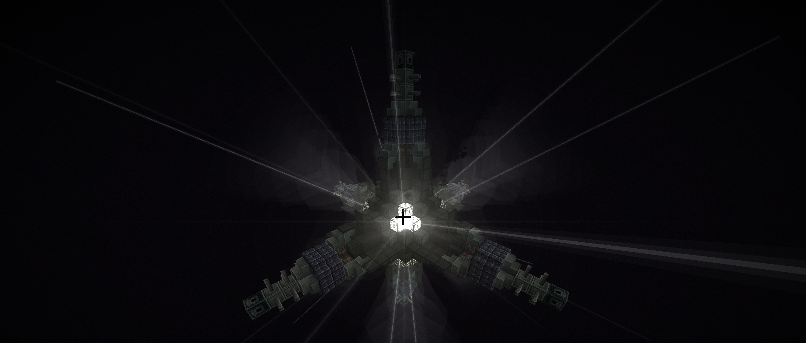
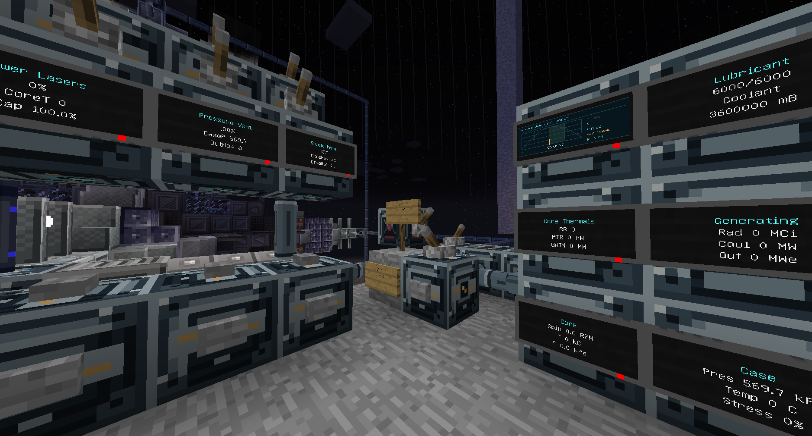
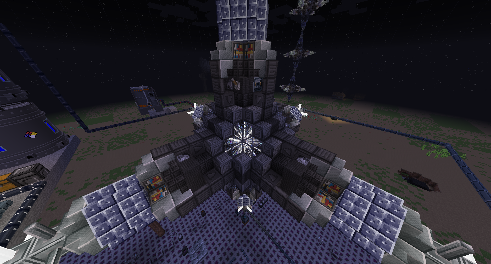
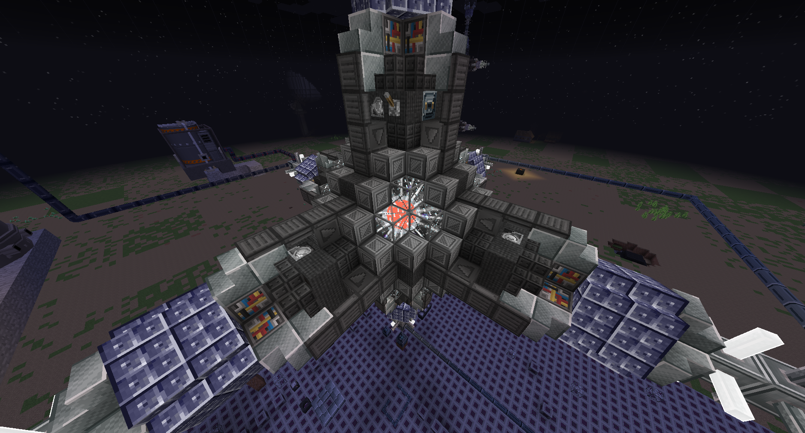

<p align="center">
  <a href="README.md">English</a> | <a href="README.ru.md">Русский</a>
</p>

<h1 align="center">HBM:STFR</h1>
<p align="center"><strong>Stabilizers Thermonuclear Fusion Reactor</strong></p>
<p align="center">Minecraft 1.12.2 · Forge · HBM:CE</p>

> A fusion reactor is only as reliable as the systems keeping it contained.

A port of the STFR reactor from [jona23's TERF datapack](https://github.com/jona23EE/TERF_datapack)
to Minecraft Forge 1.12.2, integrated with HBM's Nuclear Tech Mod: Community Edition.

Build the reactor, connect its control network, manage fuel and containment, and respond
when stabilization begins to fail.



[Features](#features) · [Installation](#installation) · [Getting started](#getting-started) · [Screenshots](#screenshots) · [Development](#development) · [Credits](#credits) · [Licensing](#licensing)

## Features

- **A six-stabilizer reactor.** Assemble and validate the structure with dedicated analysis tools.
- **Core and containment simulation.** Track temperature, pressure, rotation, fuel composition and shield stability.
- **A physical control network.** Connect Mainframes, monitors, breakers, alarms and ports with logic cables.
- **Fuel handling and maintenance.** Fill capsules, service stabilizers, replace lenses and manage coolant and steam.
- **Manual and automatic control.** Operate the reactor directly or use its autopilot systems.
- **Emergency protocols.** Diagnose failures, restore damaged systems and attempt recovery before containment is lost.
- **Reactive visuals and audio.** Volumetric light, surface lighting with shadows, electrical discharges, debris, music and announcements.
- **Russian and English localization**, including spoken announcements.

The port is under active development. Reactor behavior and balance may change between versions.

## Installation

| Component | Requirement |
| --- | --- |
| Minecraft | Java Edition 1.12.2 |
| Mod loader | Minecraft Forge for 1.12.2 |
| Game runtime | Java 8 |
| HBM:CE | 2.6.0.0 or later |
| MixinBooter | 10.7 or later |
| HBM:Space | Optional; 0.9.2 or later when installed |

1. Set up a Forge 1.12.2 instance.
2. Install HBM:CE, MixinBooter and the dependencies required by those mods.
3. Put the HBM:STFR release JAR in the instance's `mods` folder. For multiplayer, install HBM:STFR and its required mods on both the client and server.
4. Launch Minecraft and use the STFR creative tab or JEI to explore the available components.

HBM:Space is optional. The first beta release is `0.1.0-beta.1`.

Choose one playable JAR from `build/libs/`:

- **`hbmstfr-1.12.2-0.1.0-beta.1.jar`** — Java 8-compatible release.
- **`hbmstfr-1.12.2-0.1.0-beta.1-java21.jar`** — native Java 21 release for modpacks
  with a Java 21-compatible loader and dependencies.

Both contain the complete mod and are reobfuscated for gameplay. Install only one.
Java 21 gameplay compatibility has not yet been tested.
The `-dev`, `-dev-java21`, `-downgraded` and `-sources` artifacts are for development.

## Getting started

1. **Build and validate.** Assemble the reactor and use the structure analyzer to locate missing or incorrectly configured blocks.
2. **Connect the controls.** Set up a Mainframe and logic network with monitors, breakers, alarms and reactor ports. Redundant connections to different stabilizers matter during recovery.
3. **Prepare the supplies.** Provide fuel capsules, coolant, startup energy and a usable steam outlet. Check access hatches and containment.
4. **Confirm startup.** Follow the Mainframe diagnostics, engage the required systems and use KEY and SSTB when prompted.
5. **Watch the reactor.** Monitor operating conditions, maintain the structure and follow the recovery instructions when an alarm occurs.

This is a short orientation; the analyzer, Mainframe diagnostics, JEI recipes and in-game announcements provide the next steps.

## Screenshots







Emergency sequences and reactor failures: [watch on Aloyenz's YouTube channel](https://www.youtube.com/@aloyenz).

## Development

### Build and run

Use **JDK 21** to run Gradle. HBM:STFR is compiled with Java 21, then downgraded and packaged
for Java 8. A separate native Java 21 release is also built. Development Minecraft instances run on Java 8; missing toolchains can be
provisioned through Foojay. The first build requires network access to dependency repositories.

```sh
./gradlew build
./gradlew runClient
./gradlew runServer
```

On Windows, use `gradlew.bat`. If necessary, set `JAVA_HOME` to your JDK 21 installation.
Accept the Minecraft EULA yourself before running a development server.

The playable JAR is written to `build/libs/`. The build also verifies that its class files
are compatible with Java 8. Versions are configured in [gradle.properties](gradle.properties),
and dependencies in [dependencies.gradle](dependencies.gradle).

The Java entry point is [STFR.java](src/main/java/fun/aloyenz/stfr/STFR.java).

<details>
<summary>Optional HBM:Space source checkout</summary>

```sh
git submodule update --init --recursive
```

The checkout is pinned to commit `8c6ae977d64c616504bcf45ce416ed70e4d778ad`
from `nightly-2026-09-11`. It is an API reference, not a Gradle subproject.
Dependencies for development runs are resolved separately from published artifacts.

</details>


<details>
<summary>Build artifacts</summary>

| JAR suffix | Purpose |
| --- | --- |
| No suffix | Playable, reobfuscated release with Java 8 compatibility; use this in `mods/` |
| `-java21` | Complete, reobfuscated native Java 21 release for compatible modpacks |
| `-dev` | Development mappings, Java 8 bytecode and embedded compatibility API |
| `-dev-java21` | Original Java 21 bytecode in development mappings; intermediate build output |
| `-downgraded` | Intermediate Java 8 conversion before the compatibility API is embedded |
| `-sources` | Source code and resources for developers |

Java 21 modpacks can use the native `-java21` release or the Java 8-compatible release. Install only one.

</details>

### Voice assets

```sh
bash scripts/generate_voices.sh
```

The generator checks the full RU/EN dataset and rebuilds only missing or changed recordings.
It requires `voicelines/.venv`, the packages in `voicelines/requirements.txt`, and FFmpeg.
Rebuild the mod after generating audio. See the [voice tooling guide](voicelines/README.md)
for setup, previews and pronunciation overrides.

### Lighting integration

Client light snapshots are available through `StfrClientVisuals.coreLights(partialTicks)`
and the Forge event `StfrCoreLightRenderEvent`. Adapters can use `StfrCoreLight` snapshots
and disable the built-in `renderLighting`, `renderStar` and `renderExposure` passes.
Compatibility with external shader packs is not guaranteed.

### Checks

```sh
./gradlew test
python3 scripts/test_voice_segments.py
python3 scripts/test_structure_to_json.py
python3 scripts/test_import_structure_roles.py
python3 tools/test_core_light_shader.py
```

The standalone GLSL check requires system libEGL/libGL with Mesa surfaceless support.
It does not launch Minecraft.

## Credits

| Contributor | Contribution |
| --- | --- |
| **Aloyenz** | Minecraft Forge/HBM port, integration and additional development |
| **[jona23](https://github.com/jona23EE)** | Original STFR reactor design and TERF datapack implementation |

Original project: **[TERF_datapack](https://github.com/jona23EE/TERF_datapack)**.
The reactor is being ported with the original author's permission.

HBM:STFR uses [HBM:CE](https://github.com/Warfactory-Official/Hbm-s-Nuclear-Tech-CE)
and optionally [HBM:Space](https://github.com/Warfactory-Official/Hbm-s-Nuclear-Tech-CE-Space).
The build uses [RetroFuturaGradle](https://github.com/GTNewHorizons/RetroFuturaGradle)
and [JvmDowngrader](https://github.com/unimined/JvmDowngrader).

## Licensing

HBM:STFR is licensed under the **[PolyForm Noncommercial License 1.0.0](LICENSE)**,
with jona23's approval for this port. Preserve the three attribution lines in [NOTICE](NOTICE)
when distributing the licensed software. Full contributor roles are listed in [CREDITS](CREDITS).

Third-party components and recordings retain their separate terms; see
[THIRD_PARTY_NOTICES](THIRD_PARTY_NOTICES) and [LICENSES/](LICENSES/).
The playable and source JARs include these license and attribution files.
