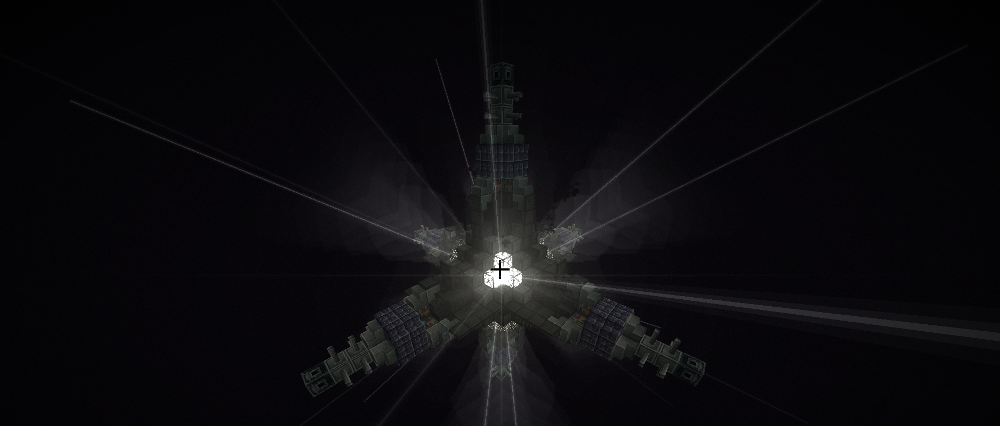
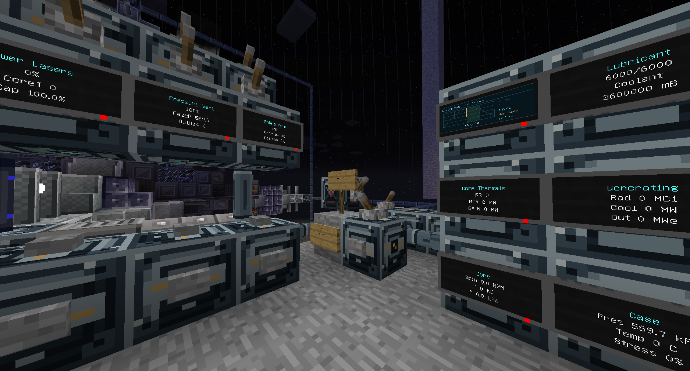
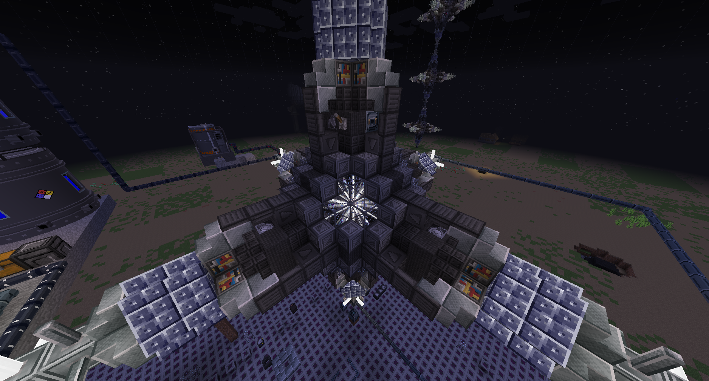
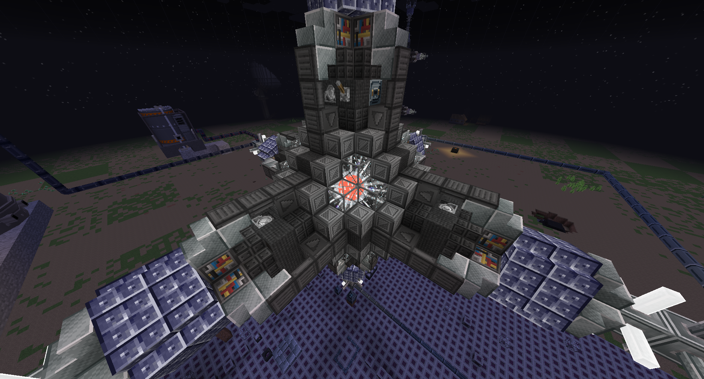

<p align="center">
  <a href="README.md">English</a> | <a href="README.ru.md">Русский</a>
</p>

<h1 align="center">HBM:STFR</h1>
<p align="center"><strong>Стабилизаторный термоядерный реактор</strong></p>
<p align="center">Minecraft 1.12.2 · Forge · HBM:CE</p>

> Термоядерный реактор надёжен ровно настолько, насколько надёжны системы его удержания.

Порт реактора STFR из [датапака TERF автора jona23](https://github.com/jona23EE/TERF_datapack)
для Minecraft Forge 1.12.2, интегрированный с HBM's Nuclear Tech Mod: Community Edition.

Постройте реактор, подключите сеть управления, обеспечьте подачу топлива и удержание
плазмы. Будьте готовы действовать, когда стабилизация начнёт отказывать.



[Возможности](#возможности) · [Установка](#установка) · [Начало работы](#начало-работы) · [Скриншоты](#скриншоты) · [Разработка](#разработка) · [Авторы](#авторы) · [Лицензирование](#лицензирование)

## Возможности

- **Реактор с шестью стабилизаторами.** Сборка и проверка структуры специальными инструментами анализа.
- **Модель ядра и удержания плазмы.** Контроль температуры, давления, вращения, состава топлива и устойчивости щита.
- **Физическая сеть управления.** Мейнфреймы, мониторы, рубильники, сигнализации и порты, соединённые логическими кабелями.
- **Топливо и обслуживание.** Заполнение капсул, обслуживание стабилизаторов, замена линз, подача теплоносителя и отвод пара.
- **Ручное и автоматическое управление.** Непосредственный контроль реактора или работа с системами автопилота.
- **Аварийные протоколы.** Диагностика отказов, ремонт повреждений и попытки восстановления до потери удержания.
- **Визуальные и звуковые эффекты.** Объёмное свечение, освещение поверхностей с тенями, электрические разряды, обломки, музыка и объявления.
- **Русская и английская локализации**, включая голосовые сообщения.

Порт находится в активной разработке. Поведение реактора и баланс могут меняться между версиями.

## Установка

| Компонент | Требование |
| --- | --- |
| Minecraft | Java Edition 1.12.2 |
| Загрузчик модов | Minecraft Forge для 1.12.2 |
| Java для игры | Java 8 |
| HBM:CE | 2.6.0.0 или новее |
| MixinBooter | 10.7 или новее |
| HBM:Space | Необязателен; при установке — 0.9.2 или новее |

1. Подготовьте сборку с Forge 1.12.2.
2. Установите HBM:CE, MixinBooter и необходимые им зависимости.
3. Поместите релизный JAR HBM:STFR в папку `mods`. Для сетевой игры установите HBM:STFR и обязательные моды как на клиент, так и на сервер.
4. Запустите Minecraft. Компоненты реактора доступны во вкладке STFR творческого режима и в JEI.

HBM:Space необязателен. Первый бета-релиз — `0.1.0-beta.1`.

Выберите один игровой JAR из `build/libs/`:

- **`hbmstfr-1.12.2-0.1.0-beta.1.jar`** — релиз с совместимостью с Java 8.
- **`hbmstfr-1.12.2-0.1.0-beta.1-java21.jar`** — нативный релиз Java 21 для сборок,
  у которых загрузчик и зависимости поддерживают Java 21.

Оба содержат полный мод и реобфусцированы для игры. Устанавливать нужно только один.
Работа в игре на Java 21 пока не проверена.
Артефакты `-dev`, `-dev-java21`, `-downgraded` и `-sources` предназначены для разработки.

## Начало работы

1. **Постройте и проверьте структуру.** Соберите реактор и используйте анализатор для поиска недостающих или неправильно настроенных блоков.
2. **Подключите управление.** Создайте логическую сеть с мейнфреймом, мониторами, рубильниками, сигнализацией и портами реактора. Запасные подключения к разным стабилизаторам важны при восстановлении.
3. **Подготовьте ресурсы.** Обеспечьте топливные капсулы, теплоноситель, энергию запуска и свободный отвод пара. Проверьте люки и герметичность.
4. **Подтвердите запуск.** Следуйте диагностике мейнфрейма, включите необходимые системы и используйте KEY и SSTB по инструкции.
5. **Следите за реактором.** Контролируйте рабочие параметры, обслуживайте конструкцию и выполняйте инструкции восстановления при тревоге.

Это краткое введение. Дальнейшие действия подскажут анализатор, диагностика мейнфрейма,
рецепты JEI и игровые объявления.

## Скриншоты







Аварийные сценарии и отказы реактора: [смотрите на YouTube-канале Aloyenz](https://www.youtube.com/@aloyenz).

## Разработка

### Сборка и запуск

Для запуска Gradle нужен **JDK 21**. HBM:STFR компилируется на Java 21, затем преобразуется
и упаковывается для Java 8. Отдельно собирается нативный релиз Java 21. Тестовые экземпляры Minecraft работают на Java 8;
недостающие JDK могут загружаться через Foojay. Первая сборка требует доступа
к репозиториям зависимостей.

```sh
./gradlew build
./gradlew runClient
./gradlew runServer
```

На Windows используйте `gradlew.bat`. При необходимости укажите JDK 21 в `JAVA_HOME`.
Перед запуском тестового сервера самостоятельно примите Minecraft EULA.

Игровой JAR появится в `build/libs/`. Сборка также проверяет совместимость его классов
с Java 8. Версии задаются в [gradle.properties](gradle.properties), зависимости —
в [dependencies.gradle](dependencies.gradle).

Точка входа Java: [STFR.java](src/main/java/fun/aloyenz/stfr/STFR.java).

<details>
<summary>Необязательная копия исходников HBM:Space</summary>

```sh
git submodule update --init --recursive
```

Копия закреплена на коммите `8c6ae977d64c616504bcf45ce416ed70e4d778ad`
из `nightly-2026-09-11`. Она служит справочником API и не является подпроектом Gradle.
Зависимости тестовых запусков отдельно загружаются из опубликованных артефактов.

</details>


<details>
<summary>Артефакты сборки</summary>

| Суффикс JAR | Назначение |
| --- | --- |
| Без суффикса | Игровой релиз с преобразованными именами и совместимостью с Java 8; устанавливается в `mods/` |
| `-java21` | Полный реобфусцированный мод с нативным байткодом Java 21 для совместимых сборок |
| `-dev` | Имена классов для разработки, байткод Java 8 и встроенный API совместимости |
| `-dev-java21` | Исходный байткод Java 21 с именами для разработки; промежуточный результат сборки |
| `-downgraded` | Промежуточное преобразование для Java 8 до встраивания API совместимости |
| `-sources` | Исходный код и ресурсы для разработчиков |

Сборки на Java 21 могут использовать нативный `-java21` или релиз с совместимостью с Java 8. Устанавливайте только один вариант.

</details>

### Озвучка

```sh
bash scripts/generate_voices.sh
```

Генератор проверяет весь набор RU/EN и пересоздаёт только отсутствующие или изменённые записи.
Нужны `voicelines/.venv`, пакеты из `voicelines/requirements.txt` и FFmpeg.
После генерации пересоберите мод. Настройка, предпрослушивание и коррекция произношения
описаны в [инструкции по озвучке](voicelines/README.ru.md).

### Интеграция освещения

Клиентские источники света доступны через `StfrClientVisuals.coreLights(partialTicks)`
и Forge-событие `StfrCoreLightRenderEvent`. Адаптеры могут использовать снимки `StfrCoreLight`
и отключать встроенные проходы `renderLighting`, `renderStar` и `renderExposure`.
Совместимость с внешними шейдерпаками не гарантируется.

### Проверки

```sh
./gradlew test
python3 scripts/test_voice_segments.py
python3 scripts/test_structure_to_json.py
python3 scripts/test_import_structure_roles.py
python3 tools/test_core_light_shader.py
```

Отдельная проверка GLSL требует системных libEGL/libGL с поддержкой Mesa surfaceless
и не запускает Minecraft.

## Авторы

| Автор | Вклад |
| --- | --- |
| **Aloyenz** | Порт на Minecraft Forge/HBM, интеграция и дальнейшее развитие |
| **[jona23](https://github.com/jona23EE)** | Оригинальная конструкция реактора STFR и реализация в датапаке TERF |

Оригинальный проект: **[TERF_datapack](https://github.com/jona23EE/TERF_datapack)**.
Перенос реактора выполняется с разрешения автора оригинала.

HBM:STFR использует [HBM:CE](https://github.com/Warfactory-Official/Hbm-s-Nuclear-Tech-CE)
и необязательно [HBM:Space](https://github.com/Warfactory-Official/Hbm-s-Nuclear-Tech-CE-Space).
Сборка основана на [RetroFuturaGradle](https://github.com/GTNewHorizons/RetroFuturaGradle)
и [JvmDowngrader](https://github.com/unimined/JvmDowngrader).

## Лицензирование

HBM:STFR распространяется под **[PolyForm Noncommercial License 1.0.0](LICENSE)**.
Применение лицензии к порту согласовано с jona23. При распространении лицензируемого
проекта сохраняйте три строки обязательных уведомлений из [NOTICE](NOTICE).
Роли авторов перечислены в [CREDITS](CREDITS).

Сторонние компоненты и записи сохраняют отдельные условия: см.
[THIRD_PARTY_NOTICES](THIRD_PARTY_NOTICES) и [LICENSES/](LICENSES/).
Игровой JAR и JAR с исходниками включают эти лицензии и уведомления об авторстве.
